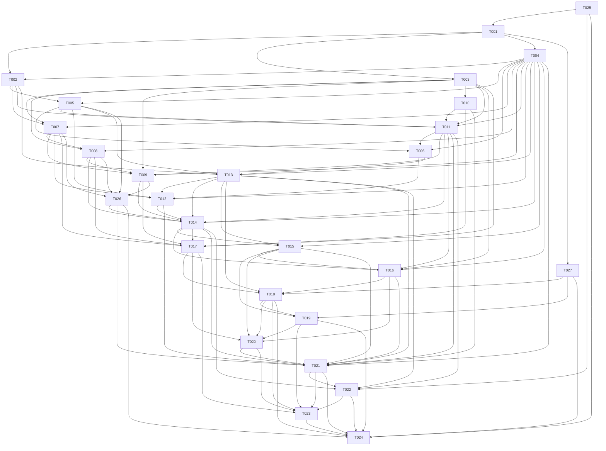

# Bugu SME v1 实施上下文

文档状态：REVIEW（文档修订草案；完整 v1 范围不变，代码实施尚未开始）
任务状态基线：TODO
最后更新：2026-10-09
代码核对基线：`63dec6de2992610865a7a103cede612e28ace203`；本轮仅文档检查，未执行 Zig/设备测试。
适用范围：`docs/tasks_sme/` 下全部任务
唯一产品终点：完整 Bugu Sequence Music Engine v1

## 1. 项目与目标

Bugu 是 Zig-first 游戏音频引擎 prototype。当前仓库已经具有 fixed-quantum mixer、64 个 real voice、稳定 voice handle、WAV/PCM preload bank、event/switch/RTPC、SFX/Music/Master bus 标签、固定 reverb effect bus、miniaudio/offline backend、空间音频、CPU/GPU 声学传播与验证脚本。

本任务集要在这些真实基础之上交付完整 SME v1，使游戏可以提交 state、parameter、context、stinger 和 duck 请求，由引擎完成：

- 复杂 tempo/meter map 和 sample-accurate transport；
- 水平重排序、条件选择、sequence/shuffle/no-repeat/history；
- entry/exit cue、fill route 和兼容性求解；
- 多 stem 原子启动、垂直重配器、real/virtual voice；
- Ogg Opus streaming、seek、loop、prefetch 和 emergency recovery；
- Bus DAG、automation ducking 和真实 signal sidechain；
- 生命周期、save/restore、hot reload、rollback；
- Zig 作者工具、`in-dreaming/gpu` 图形化 authoring 与 runtime debugger；
- 确定性 trace/replay、真实 demo、CI、设备与 8 小时压力验证。

SME v1 是完整 release，不是 MVP。TASK-001 至 TASK-027 全部完成且最终 gate 通过之前，不得把任何中间状态称为 SME v1。

### 成功标准

1. `MusicRequest -> Director -> TransitionPlan -> ScheduledCommandBlock -> Mixer -> Device/Offline PCM` 是真实主路径。
2. 所有 transition 的实际 frame 等于计划 frame；同一 group 必需 stems 的 start/cursor skew 为 0。
3. tempo map、cue/fill、logic、selector、reorchestration、streaming、sidechain、authoring 和 hot reload 都有真实实现与失败测试。
4. nominal matrix 的 command overflow、stream underrun、dropout 为 0。
5. 相同 bank/profile、seed、save state 和完整 versioned replay inputs（含 acceptance frame、readiness、device events）得到跨平台 bit-identical canonical schedule trace；live timing 可变。
6. headless validation、GPU UI smoke、真实设备 smoke 和至少 8 小时压力 gate 通过。
7. 不存在 stub、固定结果、外部播放器、静默 fallback 或把 preload 冒充 streaming 的路径。

## 2. 事实来源

### 2.1 架构与约束

- `docs/design/arch_sme.md`：SME v1 范围、模块、数据、线程、错误、验收和 ADR 的权威来源。
- `docs/research/kcd.md`：水平重排序、垂直分层、entry/exit、fill 和创作工作流来源。
- `docs/research/kcd.sme.md`：Bugu 现状评估。其“先做简化版”建议已被 `arch_sme.md` 的完整 v1 决策覆盖。
- `docs/tasks/asetup.md`：Zig、submodule、实时安全、fallback、anti-mock 和 `in-dreaming/gpu` 硬约束。
- `docs/design/audio-runtime-contract.md`：Game/Control/Worker/Render 线程边界。
- `docs/design/runtime-embedding-v1.md`：已实现且 compatibility-frozen 的生产 ControlRuntime/RuntimeRenderer 嵌入路径；不得被 Engine-only 方案绕过。
- `.agents/skills/architecture-task-breakdown/SKILL.md`：本仓库实际存在的任务拆分流程；未发现独立 `grill-me-docs`、`to-spec`、`to-tickets` 定义，本文不声称执行这些不存在的流水线。
- `docs/design/audio-engine-design.md`：现有 L0-L9、mixer、bank、event、bus 与性能方向。
- `docs/product-readiness-roadmap.md`：当前 prototype 限制与 release gate。

执行者只需完整阅读本文件与当前任务文件。上列文件用于追溯，不得把重新阅读它们作为完成当前任务所需的隐藏前提。

### 2.2 当前代码事实

| 路径 | 已确认职责与限制 |
|---|---|
| `src/core/engine.zig` | legacy Engine 默认 48 kHz/256 frames/stereo；直接拥有独立 mixer，不能假定 production backend 经过它 |
| `src/runtime/runtime.zig` | production ControlRuntime、不可变 RenderSnapshot、RuntimeRenderer 自有 mixer；SampleOwner pin/completion/shutdown；SME 尚未接入 |
| `src/mixer/mixer.zig` | 64 个 voice slot；mono sample 到 stereo；gain/pan/filter/pitch/reverb send；虽已有 `VoiceState.virtual` 枚举和计数槽，但没有进入/退出、cursor 推进或恢复执行路径，因此尚无可用的 virtual voice；无 atomic group、Bus DAG |
| `src/assets/bank.zig` | WAV PCM 导入为单声道 48 kHz float32；未版本化 TOML + blob；全量 preload |
| `src/events/runtime.zig` | 即时 play/switch/RTPC/stop；不能保证音乐边界或多 stem 同步 |
| `src/device/device.zig` | legacy 与 Runtime 两类 backend；RuntimeFixedQuantumAdapter 当前 stereo 且可能提前生成整 quantum |
| `src/acoustic/acoustic.zig` | CPU reference acoustic response 与 mixer mapping；只能作为可选音乐参数输入 |
| `src/bugu_audio.zig` | 当前公共 Zig module 汇总入口 |
| `build.zig` | 单体构建入口；已有 unit test、demos 和 acoustic visualizer |
| `.gitmodules` | 已有 miniaudio 与 `in_dreaming_gpu`；尚无 libogg/libopus |
| `third_party_adapters/` | 已有 miniaudio、gpu adapter；尚无 codec adapter |
| `tools/run_validation.ps1` | 当前 CPU/offline gate 与显式 GPU acoustic gate |

现有命令：

```powershell
zig build test
powershell -ExecutionPolicy Bypass -File tools\run_validation.ps1
zig build acoustic-visualizer-smoke
```

任务中标注“新增命令”的命令只有在对应任务完成后才可使用。

### 2.3 文档与实现差异

`arch_sme.md` 是目标 contract，不代表代码已实现。当前缺失：绝对 frame command block、multichannel、atomic group、可运行的 music virtual voice、tempo map、Music Director、cue/fill planner、Opus/streaming、Bus DAG/sidechain、MusicRuntime、music bank、作者工具和 SME 验证。任务不得把设计类型名或未接通的枚举值当作已存在能力。

## 3. 当前架构

当前生产调用链（兼容冻结）：

```text
Host -> ControlRuntime -> RenderSnapshot -> RuntimeRenderer (owns Mixer)
     -> RuntimeFixedQuantumAdapter -> RuntimeMiniaudioBackend / RuntimeOfflineBackend
```

独立 legacy demo 调用链：

```text
Game/demo
  -> EventRuntime 或直接 Engine API
  -> Engine.start/update/stop voice
  -> Mixer.render(fixed quantum)
  -> MiniaudioBackend 或 OfflineBackend
```

当前资产链：

```text
WAV PCM
  -> importToBank
  -> 未版本化 TOML + mono float32 blob
  -> loadBank 全量加载
  -> SoundRef.samples
```

当前不变量：

- render thread 无 allocation、lock、file I/O、log formatting、GPU wait、lazy load；
- GPU 声学是加速候选，CPU 是 correctness reference；
- 第三方必须是 git submodule；
- 引擎主体必须是 Zig；
- 可视工具必须使用 `in-dreaming/gpu`；
- fallback 必须运行真实降级路径并显式报告。

## 4. 目标架构与统一约定

### 4.1 目标数据流

```text
Game/API
 -> bounded MusicRequestQueue
 -> Music Director + Logic + Selector History
 -> TempoClock + Transition Planner
 -> Prefetch Coordinator + Layer Controller
 -> ControlRuntime publication: RenderSnapshot + immutable ScheduledCommandBlock
 -> RuntimeRenderer: single scheduler/render_frame + Mixer VoiceGroup + Bus DAG
 -> Device/Offline

Worker/I/O -> codec/decode/stream completions -> Control
Render -> execution receipts/atomics -> Control
Control -> trace/replay/telemetry -> tools/CI
Authoring -> shared schema/compiler/runtime preview -> compiled MusicBank
```

### 4.2 冻结模块和新增路径

以下路径是计划新增路径；任务文件会指定唯一所有者：

```text
src/music/
  api.zig
  root.zig
  ids.zig
  errors.zig
  contract.zig
  scheduler.zig
  trace.zig
  replay.zig
  clock.zig
  logic.zig
  selector.zig
  director.zig
  planner.zig
  layers.zig
  runtime.zig
  stinger.zig
  acoustic_mapping.zig
  save_state.zig
src/mixer/
  channel_layout.zig
  music_group.zig
  virtual_voice.zig
  bus_graph.zig
  sidechain.zig
src/assets/
  music_bank.zig
  music_schema.zig
src/events/
  runtime_adapter.zig
src/streaming/
  music_stream.zig
  prefetch.zig
third_party_adapters/
  opus/
tools/sme_compiler/
tools/sme_authoring/
tools/sme_debug/
examples/sme/
tests/sme/
docs/validation/sme/
build_support/sme_steps.zig
```

实际实现可在 TASK-001 的契约审查中做无行为差异的路径微调，但必须同步本文件和全部受影响任务，不能各任务自行发明第二套命名。

公共 façade 与聚合层的职责冻结如下：

- `src/music/api.zig` 是 `bugu_audio.music` 对外暴露的唯一公共 façade；只转发已实现且通过验收的公共类型与操作。
- `src/music/root.zig` 是 SME 内部模块聚合入口，不作为游戏侧第二套公共 API。
- `src/assets/music_schema.zig` 与 `src/assets/music_bank.zig` 拥有编译资产 schema/loader；公共调用方只能通过 `music/api.zig` 暴露的稳定类型访问，不新增并行的 `music/assets.zig` 实现。
- `build_support/sme_steps.zig` 是可跟踪的 Zig 构建扩展。仓库 `build/` 已被 `.gitignore` 用作生成目录，禁止在其中放源文件。
- `build_support/sme_steps.zig` 必须为 `tests/sme/*.zig` 提供确定性的发现/注册规则，或等价的无需共享聚合文件的稳定注册 API；任何新增 SME 测试都必须真实成为现有 `zig build test` 的依赖。

### 4.3 ID、版本和错误

- 公共 ID：FNV-1a 64，bank build 时检测 hash collision。
- Bank：`major.minor`；major 不兼容拒绝，minor 由 capability bits 检查。
- 整包：SHA-256 content hash + monotonic generation。
- 每个 production context 的 `ControlRuntime` 一个主 `MusicRuntime`/transport；对应 `RuntimeRenderer` 独占 mixer/scheduler/render_frame。legacy Engine/EventRuntime 显式 adapter 迁移，不能重复驱动同一 backend。
- 错误集基线：`InvalidState`、`InvalidHandle`、`InvalidBankVersion`、`UnsupportedCapability`、`InvalidMusicGraph`、`InvalidTempo`、`MisalignedStems`、`TransitionNotFound`、`TargetNotResident`、`VoiceBudgetExceeded`、`CommandQueueFull`、`StaleAssetGeneration`、`StreamUnderrun`、`UnsupportedOperation`。
- render thread 只写固定计数/receipt，不格式化错误文本。

### 4.4 时间与调度

- 唯一权威时钟是 `u64 render_frame`。
- 作者 tempo：PPQ 默认 960 ticks/quarter-note（允许24–9600的24整数倍），milli-BPM 为 quarter-note BPM（1000–1000000）。meter numerator1–32、denominator1/2/4/8/16/32；tempo spans≤65536、grid entries≤16777216是提出的格式安全上界，并非平台可达容量；003/007须按实际字节/峰值内存测出不高于它们的profile有效上限并序列化校验；bar ticks=`PPQ*numerator*4/denominator`。`next_beat` 按 beat_groups（denominator-note units，组和=numerator）；simple 默认每单位一组，6/8=[3,3]、9/8=[3,3,3]、12/8=[3,3,3,3]，不规则 meter 显式分组。compiler 生成整数 `BeatGrid`、`BarGrid`、`TempoSpan`、`CueTable`。
- linear_seconds 表示 BPM 随秒线性；Q四分音符、B0/B1 的 duration=`120*Q/(B0+B1)`，q(t)=`(B0*t+(B1-B0)*t*t/(2*T))/60`。B0=B1用有理常速；不可换成 ticks-linear。绝对坐标最终只舍入一次，nearest ties-to-even；sample anchors 优先，验证名义残差<1sample后按相邻 anchor 名义elapsed-time比例有理线性插值残差；超限拒绝，loop闭合0frame，不累积逐拍舍入。
- runtime 不用 `f32` 累加 beat phase。
- transition 使用严格下一个边界；紧急 stop 例外且必须短 ramp。
- 同 frame 命令按 `(execute_frame, sequence)` 稳定排序。
- 同一 transition 的 group command 原子入队；容量不足整组失败。

### 4.5 音乐领域对象

- `MusicState`：互斥主状态。
- `Theme`：作品/配器集合。
- `Segment`：可 loop/跳转的音乐时间段。
- `Layer`：共享 segment cursor 的 stem。
- `Intensity`：连续重配器输入，不复制 state。
- `MusicCue`：entry/exit/both/stinger/fill entry/fill exit。
- `FillRoute`：source exit 到 target entry 的零到多个 fill segments。
- `SegmentSelector`：fixed/sequence/weighted random/shuffle/no-repeat/condition/history。
- `MusicVoiceGroup`：必需 layers 原子 start/seek/stop，共享 cursor/loop epoch。

### 4.6 线程和所有权

| 线程 | 允许 |
|---|---|
| Game | 提交 bounded request，读取上一 snapshot |
| Audio Control | Director、clock lookup、planner、prefetch、自动化编译、trace |
| Worker/I/O | bank、codec、decode、stream、非实时校验 |
| Audio Render | immutable command、group cursor、DSP/mix、atomic telemetry |
| GPU/tool | authoring/debug；不得成为 transport 或 render 依赖 |

`MusicBank` 拥有 metadata/blob/stream descriptors；`MusicRuntime` 持有 generation lease；block/snapshot/group/voice/worker job/pending PCM 都有可审计 lease。Render 在释放 snapshot lease 前 pin voice；generation 延迟到全部 references 和 completion drain 后由非实时 owner 回收。shutdown 先拒绝请求、取消未来阶段、ramp/drain、收齐回执、停止backend并flush FIFO、停止worker，再销毁；callback不得free/join/wait。

### 4.7 Codec、channel 和 streaming

- v1 必需 Resident PCM 与 Ogg Opus。
- `libogg`、`libopus` 必须作为 submodule，Zig adapter 隔离第三方类型；TASK-010拥有实际Opus encoder/Ogg mux producer，长WAV forced-streaming必须生成真实encoded bytes再建index，不只生成descriptor。
- channel layout：mono、stereo、5.1、7.1、显式 mask。
- Opus 必须处理 pre-skip、end padding、sample-accurate seek 和 loop。
- 音乐内部sample时间域48kHz，TASK-010确定性SRC；每segment全部stem解码float32 bytes总和严格大于profile resident_limit_bytes（base默认16MiB）强制streaming，等于可resident；超限emergency拒绝构建，总resident另受006预算约束。
- 长 segment 强制 streaming；worker 填充预分配 ring；render 不解码。
- 必需 layer underrun 进入显式 degraded/emergency 状态，不能让其他 stem 静默继续。

### 4.8 Authoring 和可视化

- 作者源：版本化 TOML project + 独立音频文件。
- compiled binary bank 是唯一 runtime 输入。
- CLI 与 GUI 共享 schema/compiler/director/planner/validation。
- GUI 使用 `in-dreaming/gpu`，不引入第二套窗口/RHI。当前 pinned GPU `8b0f2bc657775d899dc4d724918a1e6be9ffa450` 未提供完整 text/IME/focus UI contract，adapter 仅 C import；TASK-027 先补平台基础与合格 pin，再由 TASK-018/019 集成。
- headless CI 始终可运行，不依赖 GPU。

### 4.9 任务状态、分配与证据

任务的机器状态与 `docs/tasks/asetup.md` 统一，只允许：

- `TODO`：未开始；
- `IN_PROGRESS`：已分配 Owner 和 Reviewer，输入工件可用，正在实施；
- `BLOCKED`：存在文档中已记录的外部阻塞；
- `REVIEW`：输出工件与实施证据已完整，等待独立审查；
- `DONE`：完成定义全部满足且审查通过。

`文档状态`、architecture 版本和 release verdict 不是任务状态，不得写入任务的 `状态` 字段。中文状态词只用于解释，不作为机器值。状态变化必须同步本文件第 6 节总览、对应任务元数据和该任务的“活动日志”。

每个任务的 `Owner`、`Reviewer`、`实施角色` 和 `工作量等级` 都是必填元数据。未分配任务使用机器值 `UNASSIGNED`；从 `TODO` 进入 `IN_PROGRESS` 前必须替换为仓库可追踪的人员或团队标识。Reviewer 不得与 Owner 相同。工作量等级用于排期而非替代实现拆分：

- `M`：单一组件、预计 3–5 工程人日；
- `L`：跨相邻组件、预计 6–10 工程人日；
- `XL`：预计超过 10 工程人日；进入 `IN_PROGRESS` 前必须在任务内写出可独立审查的子交付物和检查点。

各任务的“前置条件”是规范输入工件清单；“文件变更”、新增命令和验证产物共同构成规范输出工件清单。硬依赖只表示任务 ID，不替代对所需接口、schema、fixture 或决策的明确列举。

每个任务实施后在其文档追加：

```markdown
## 实施证据
- Owner:
- Reviewer:
- Commit:
- Commands:
- Inputs:
- Results:
- Artifact summary:
- Failures/limits:
- Acceptance mapping:
```

同时写入经脱敏的 `docs/validation/sme/TASK-NNN/evidence.md`。大体积或自动生成的原始产物写入已忽略的 `zig-out/sme-validation/TASK-NNN/`，不得提交到仓库。`REVIEW` 要求任务文档、evidence 文件和当前 commit 一致。

### 4.10 Trace、报告与产物隐私

- trace、JSON、CSV、WAV、report 和 recovery 文件默认不得包含用户名、机器名、绝对本机路径、环境变量值、token/key、私有 stem 原始文件名、未脱敏设备序列号或私有目录结构。
- 仓库内路径统一写为 repo-relative；仓库外输入只记录逻辑 asset ID、content hash、媒体格式和必要的许可标识。
- 可共享环境字段限于：OS 名称/版本/build、CPU architecture、设备 model、driver version、Zig/toolchain version、commit、bank build ID/hash、测试 seed 和 profile ID。设备 model 不附带序列号。
- schema 中每个可导出字段必须标注 `public`、`sensitive` 或 `local_only`；exporter 默认丢弃后两类，只有显式本地调试模式才能保留 `local_only`。
- 原始 CI artifact 只允许包含脱敏 trace、WAV、report 与机器可读 JSON，不包含源 stems、recovery 副本、cache、core dump 或含本机路径的完整环境转储。
- GitHub Actions artifact 默认保留 14 天；release qualification 只长期提交小型 evidence/manifest/hash，不提交原始大文件。若组织策略要求更短保留期，以更短者为准；延长必须有 ADR。
- TASK-018 recovery 固定写入 `<project>/.sme-recovery/`，不覆盖 source，项目模板必须忽略该目录；smoke/CI 完成后不得归档 recovery。

### 4.11 定量参数冻结规则

未在架构中冻结的数字不得靠隐藏常量补齐。负责任务必须在实现前把取值、单位、适用 profile、内存/时延影响和验证 oracle 写入公共 schema、测试 fixture 与实施证据。下表是最迟冻结点：

| 参数族 | 必须冻结的字段/判据 | 最迟所有者 |
|---|---|---|
| 调度容量 | request/command/receipt capacity、每 block/group 上限、emergency lane、late budget | TASK-002；request queue 的 game/control 部分由 TASK-014 联合确认 |
| Bank/logic 上限 | 各 table count、logic instruction/stack、planner phase/candidate 上限 | TASK-003、TASK-008、TASK-009 |
| 声道转换 | canonical channel order/mask 与每个支持布局的 downmix/upmix matrix | TASK-005 |
| Voice 预算 | real/virtual/group/stinger 上限、audibility 定义、hysteresis 与 drop 计量 | TASK-006 |
| 音乐时间 | 默认/允许 PPQ、BPM/meter 范围、anchor 与 loop 误差 | TASK-007 |
| Streaming | ring/chunk/job capacity、critical/low/high watermark、prefetch lead/deadline | TASK-011 |
| 自动化/DSP | ramp/click oracle、detector/meter window、lookahead/latency、preset 参数范围 | TASK-012、TASK-013、TASK-015 |
| Generation | migration map version、history capacity、rollback retention | TASK-016 |
| Tooling 协议 | CLI diagnostics、authoring smoke、debug handshake/snapshot、recovery 版本 | TASK-017、TASK-018、TASK-019 |
| Demo/release | 资产许可与体积预算、CI artifact schema/retention、device matrix/profiler overhead、package layout | TASK-020、TASK-021、TASK-022、TASK-023 |

如果负责任务无法用真实测试冻结参数，状态必须为 `BLOCKED` 或保持 `IN_PROGRESS`，不得以“稳定”“正确”“真实”“无 click”等非量化词进入 `REVIEW`。


### 4.12 取消、执行和设备 epoch

plan 生命周期为 prepared/published/acquired/partially_executed/complete；acquire/publication 不等于执行。每阶段 `(transport_epoch,plan_id,plan_epoch,phase_id,asset_generation)` 唯一。Control 在预留 system lane 请求 invalidation，Render 在 atomic group 执行前 gate 按序裁决；同 frame system invalidation 优先，最终 token check+execution claim 是线性化点。prepared/published/acquired 的未执行阶段可取消；部分执行保留真实 phase receipt，取消剩余阶段，不回滚已发生声音。cancel_requested 不是取消成功；receipt 返回 effective frame、执行 phase set 和 too_late。每 phase 仅有一次 executed 或 cancelled 终态。

commit_horizon 为已开始/完成不可撤销混音的 exclusive frame 上界，含提前生成未交付的PCM。Control 不能撤回这些帧，只能在最早安全frame发短ramp/暂停；pending block 即使已acquired，只要未跨执行gate仍可失效。普通music stop/pause/reload不flush已混SFX的pending PCM，只报告尾部延迟；仅device discontinuity按epoch flush。多fill的stop/pause/reload取消全部未来phase/automation，根据已执行phase和实际groups重算，无法续接走明确emergency/stop。pause仅冻结music cursor，SFX和render_frame继续；resume新epoch重排。reload默认旧group持旧lease收尾，未来旧plan不能启动。

render_frame、submitted_frames、delivered_frames（可选设备已播放位置，带exact/estimated/unavailable及误差；不等同submitted）分开；PCM FIFO记录device/transport epoch与frame range。设备真实loss通知进入bounded Control event，不在callback reopen。loss使未来plan失效并flush旧epoch pendingPCM，不回滚render_frame；硬件不可撤回尾声记录不确定窗口。默认restart_at_bar从最后committed state重入；resume_phase只在位置误差与cache满足profile时允许，否则明确失败或经调用者允许fallback。

### 4.13 Replay inputs 与测量

ReplayInputV2 与 ScheduleTraceV2 分别表示重放输入和canonical输出。ReplayInputV2 记录schema/compiler/algorithm version、bank hash、profile、seed/save、request accepted_control_frame及tick/order、量化control/acoustic输入、worker job/generation/result/ready frame/readiness version、device loss/reopen/flush epoch与pause/resume。live可因I/O/线程时序不同选择不同合法defer；canonical replay固定注入顺序/时刻，并预先准备真实PCM，准备不及则失败，不伪造readiness。跨平台golden必须比较完整canonical bytes；另记录command/invalidation batch的render admission/visibility gate序号/frame、batch ID/hash、observed commit_horizon、admitted/late/rejected与顺序；replay按gate放行重新计算的batch并重算execution/cancel winner，不注入最终outcome。wall-clock profiling不进入该trace。

计量区分stream_starvation、callback_deadline_miss、backend报告underrun和physical glitch。TASK-004/022必须先故障注入证明增长、清零/单调/线程读安全和Windows/Linux callback timing hook，再跑nominal8小时零故障gate。软件零计数不能冒充物理无glitch证据；物理结论需loopback/外部录音。TASK-025的MPSC序号倒置/旧snapshot重启one-shot是待验证静态风险，不是已复现故障。

### 4.14 独立审查、早期切片和依赖类型

任务是epic，命名子交付物是一次实现/审查单位。每个子交付物在任务日志有Owner/Reviewer、输入版本、commit、test、verdict，Review独立于后续epic；整体task仍须全项DONE。contract依赖表示类型/schema已可编译且有fixture；implementation依赖表示真实实现可用；integration依赖表示该实现已通过指定公共路径测试。三类均是硬依赖，不能用同波次协作遮盖未交付输入。纯协作不加硬edge，也不能完成依赖真实实现的验收。

TASK-025在SME前验证生产底座；TASK-001建立持续CI/test发现；TASK-026在全功能TASK-014之前以真实bank、Director、TASK-009同一planner的resident/no-fill场景、scheduler、groups和RuntimeOffline backend交付resident垂直切片（并测SFX并行）。它只是内部检查点，不替代streaming/GUI/完整release。TASK-021最终汇总并扩大全量矩阵，不能等它才接CI。

## 5. 实施范围

### 范围内

- `arch_sme.md` 中全部 SME v1 能力；
- 必要的现有 mixer/engine/bank/device/event 重构；
- codec submodule、authoring/debug tooling、demo、CI、文档和 qualification；
- 旧 event/bank 的兼容与显式迁移。

### 范围外

- DAW/谱面/波形编辑器；
- 生成式作曲、实时 MIDI/VST；
- 运行时音频和声分析；
- sample-level GPU mixer；
- 网络/多人音乐同步；
- 与 SME 无关的声学 solver 扩展。

## 6. 任务总览

本表是 `docs/tasks_sme/` 的机器可读状态总览；状态变化必须同时更新本表与对应任务文件。`docs/tasks/tasks.md` 继续只跟踪原有任务，不重复登记本独立任务包。

| ID | 状态 | 标题 | 交付结果 | 硬依赖 | 波次 |
|---|---|---|---|---|---:|
| TASK-001 | TODO | [冻结 SME 公共契约并建立可编译模块扩展点](task-001-sme-contract-module-seams.md) | 冻结 ID/error/API/thread/source tree，建立可编译 module seam | TASK-025 | 1 |
| TASK-002 | TODO | [实现绝对 render-frame scheduler 与原子 command block](task-002-absolute-frame-scheduler.md) | quantum 内 sample-offset、原子 command group、receipt | TASK-001、TASK-004 | 3 |
| TASK-003 | TODO | [实现版本化 MusicBank schema 与 compiler core](task-003-versioned-music-bank.md) | v1 tables/capabilities/hash/TOML parse/校验 | TASK-001 | 2 |
| TASK-004 | TODO | [实现 SME trace、telemetry 与 deterministic replay contract](task-004-trace-telemetry-replay.md) | 结构化 trace、atomic counters、deterministic replay format | TASK-001 | 2 |
| TASK-005 | TODO | [实现 multichannel mixer 与原子 MusicVoiceGroup](task-005-multichannel-voice-groups.md) | mono/stereo/5.1/7.1、原子 group、0 stem skew | TASK-002、TASK-004 | 4 |
| TASK-006 | TODO | [实现 music virtual voice 与平台预算策略](task-006-virtual-voice-budgets.md) | music virtualize/realize、保护类、drop rank、profile | TASK-004、TASK-005、TASK-011 | 6 |
| TASK-007 | TODO | [实现复杂 tempo/meter compiler 与 sample-accurate Clock](task-007-tempo-map-clock.md) | ramp/meter/pickup/loop grid、frame/tick/bar 查询 | TASK-002、TASK-003、TASK-004 | 4 |
| TASK-008 | TODO | [实现 bounded logic、Music Director 与 SegmentSelector](task-008-logic-director-selectors.md) | bounded bytecode、仲裁、sequence/shuffle/history | TASK-003、TASK-004、TASK-007 | 5 |
| TASK-009 | TODO | [实现 Entry/Exit Cue、Fill Route 与 Transition Planner](task-009-cue-fill-transition-planner.md) | entry/exit/fill/compatibility 联合求解与计划 | TASK-003、TASK-004、TASK-007、TASK-008、TASK-011 | 6 |
| TASK-010 | TODO | [交付 Ogg Opus、确定性媒体导入与质量/seek 编译产物](task-010-ogg-opus-adapter.md) | codec/SRC、loop/DC/truepeak/RMS/LUFS、resident gate、chunk/seek producer | TASK-003 | 3 |
| TASK-011 | TODO | [实现音乐 streaming、prefetch、seek 与 emergency recovery](task-011-streaming-prefetch-seek.md) | ring/cache/watermark、group readiness、emergency | TASK-002、TASK-003、TASK-004、TASK-005、TASK-010 | 5 |
| TASK-012 | TODO | [实现 Layer Controller 与完整重配器](task-012-layer-reorchestration.md) | intensity/context 驱动 layer/variant/filter/send/bus | TASK-004、TASK-005、TASK-006、TASK-007、TASK-013 | 8 |
| TASK-013 | TODO | [实现 Bus DAG、automation ducking 与真实 signal sidechain](task-013-bus-dag-sidechain.md) | 编译 bus graph、detector/compressor、meter | TASK-002、TASK-004、TASK-005、TASK-006 | 7 |
| TASK-014 | TODO | [集成完整 MusicRuntime 公共主链与生命周期](task-014-music-runtime-integration.md) | 公共 API、生命周期、save/restore、真实主链 | TASK-004、TASK-008、TASK-009、TASK-011、TASK-012、TASK-013、TASK-026 | 9 |
| TASK-015 | TODO | [实现 Stinger、duck request 与 acoustic-to-music 映射](task-015-stinger-duck-acoustic.md) | stinger scheduler、automation duck、acoustic profile | TASK-004、TASK-013、TASK-014 | 10 |
| TASK-016 | TODO | [实现 MusicBank hot reload、generation migration 与 rollback](task-016-hot-reload-rollback.md) | lease、迁移、旧 voice 安全、rollback | TASK-003、TASK-004、TASK-011、TASK-014、TASK-015 | 11 |
| TASK-017 | TODO | [实现 headless authoring core 与 SME compiler CLI](task-017-headless-authoring-cli.md) | project import/edit validate/build/preview core | TASK-003、TASK-007、TASK-008、TASK-009、TASK-010、TASK-014 | 10 |
| TASK-018 | TODO | [实现 in-dreaming/gpu SME 作者应用](task-018-gpu-authoring-app.md) | graph/timeline/cue/fill/layer 编辑、preview/live tuning | TASK-013、TASK-016、TASK-017、TASK-027 | 12 |
| TASK-019 | TODO | [实现 in-dreaming/gpu SME runtime 可视调试器](task-019-runtime-visual-debugger.md) | transport/candidate/layer/bus/stream/trace 视图 | TASK-015、TASK-018、TASK-027 | 13 |
| TASK-020 | TODO | [交付完整 SME 示例项目与真实运行 demo](task-020-complete-sme-demo.md) | 真实 bank/stream/state/fill/sidechain/hot reload 演示 | TASK-015、TASK-016、TASK-017、TASK-018、TASK-019 | 14 |
| TASK-021 | TODO | [集成并资格验证 SME 全量矩阵、golden replay 与持续 CI](task-021-full-validation-replay-ci.md) | unit/integration/golden/failure matrix、wrapper、CI | TASK-004、TASK-010、TASK-011、TASK-012、TASK-013、TASK-014、TASK-015、TASK-016、TASK-020、TASK-026 | 15 |
| TASK-022 | TODO | [完成实时安全审计、真实设备与 8 小时压力 gate](task-022-realtime-device-stress.md) | RT audit、Windows device、长时无 dropout/underrun | TASK-011、TASK-013、TASK-014、TASK-021、TASK-025 | 16 |
| TASK-023 | TODO | [完成 SME release packaging、legacy迁移与用户文档](task-023-packaging-migration-docs.md) | release package、legacy migration、author/runtime guides | TASK-017、TASK-018、TASK-019、TASK-020、TASK-021、TASK-022 | 17 |
| TASK-024 | TODO | [执行 SME v1 产品资格审查并给出唯一发布结论](task-024-v1-product-qualification.md) | 逐项证据矩阵和唯一 release verdict | TASK-018、TASK-019、TASK-021、TASK-022、TASK-023、TASK-025、TASK-026、TASK-027 | 18 |
| TASK-025 | TODO | [验证并修复生产 runtime 前置不变量](task-025-production-runtime-prerequisites.md) | 生产队列/one-shot/RT lease前置测试及必要修复 | 无 | 0 |
| TASK-026 | TODO | [验证早期真实音乐与 SFX 公共路径](task-026-early-public-runtime-slice.md) | public runtime真实两stem+SFX切片、早期CI | TASK-005、TASK-007、TASK-008、TASK-009 | 7 |
| TASK-027 | TODO | [补齐 GPU 作者工具输入与文本基础](task-027-gpu-ui-input-foundation.md) | GPU输入/text/IME/focus基础、合格submodule pin | TASK-001 | 2 |

## 7. 依赖图与执行波次

`dependencies.json` 是硬依赖与波次的规范机器清单；contract/implementation/integration类型在其中逐edge标注。表、图、任务元数据必须与它一致。TASK-025在编号较后但执行最早，稳定ID不表示先后。

`dependencies.json` 是硬依赖与波次的规范机器清单；contract/implementation/integration类型在其中逐edge标注。表、图、任务元数据必须与它一致。TASK-025在编号较后但执行最早，稳定ID不表示先后。

`dependencies.json` 是硬依赖与波次的规范机器清单；contract/implementation/integration类型在其中逐edge标注。表、图、任务元数据必须与它一致。TASK-025在编号较后但执行最早，稳定ID不表示先后。



执行波次（同波次仅在共享文件所有权规则下并行；不是日程承诺）：

- 波次 0：TASK-025。
- 波次 1：TASK-001。
- 波次 2：TASK-003、TASK-004、TASK-027。
- 波次 3：TASK-002、TASK-010。
- 波次 4：TASK-005、TASK-007。
- 波次 5：TASK-008、TASK-011。
- 波次 6：TASK-006、TASK-009。
- 波次 7：TASK-013、TASK-026。
- 波次 8：TASK-012。
- 波次 9：TASK-014。
- 波次 10：TASK-015、TASK-017。
- 波次 11：TASK-016。
- 波次 12：TASK-018。
- 波次 13：TASK-019。
- 波次 14：TASK-020。
- 波次 15：TASK-021。
- 波次 16：TASK-022。
- 波次 17：TASK-023。
- 波次 18：TASK-024。

### 共享文件所有权

| 共享位置 | 所有者与合并顺序 |
|---|---|
| `src/bugu_audio.zig` | TASK-001 建立并固定 `music -> src/music/api.zig` seam；TASK-023 仅做 release surface 收口。TASK-014 在 `api.zig` 扩展 runtime，不改 façade 指向 |
| `src/runtime/runtime.zig` / `src/device/device.zig` | TASK-025基线；TASK-002 scheduler；TASK-005 layout/FIFO；TASK-011 worker/completion扩展；TASK-026早期接线；TASK-014 lifecycle/recovery；TASK-016 generation；后续TASK-022仅stress验证。按此顺序合并，跨任务不能另起owner |
| `src/core/engine.zig` / `src/events/runtime.zig` | legacy兼容由TASK-001冻结；control adapter由TASK-014唯一实现，TASK-023迁移文档；不得添加production第二mixer |
| `src/mixer/mixer.zig` | TASK-002 command seam；TASK-005 multichannel/group；TASK-006 virtualization；TASK-013 Bus DAG，依赖顺序已串联 |
| `src/assets/bank.zig` | TASK-003 仅添加兼容桥；TASK-016 generation/hot reload；旧 bank 行为不得被其他任务重写 |
| `build.zig` / `build_support/sme_steps.zig` | TASK-001唯一维护聚合/发现规则；之后各任务在独立build fragment和test文件注册，不争改聚合入口。TASK-025 baseline workflow先建立，001扩展持续SME CI，021最终矩阵。TASK-010与027可并行，必须使用独立fragment；禁止在忽略目录build/放源文件 |
| `tools/run_validation.ps1` | TASK-021 唯一功能所有者；TASK-022 只增加被脚本调用的独立 stress 工具，TASK-023 不改 gate |
| `tools/sme_ui/` / GPU adapter | TASK-027基础与pin；TASK-018作者UI仅消费；TASK-019debug UI仅消费，若基础需改先独立审查027扩展 |
| `tools/sme_authoring/` | TASK-017 core/CLI；TASK-018 UI；TASK-019 不得在此目录实现 runtime debugger |
| `docs/validation/sme/` | 各任务写 `TASK-NNN/evidence.md` 脱敏摘要；原始产物写 `zig-out/sme-validation/TASK-NNN/`。TASK-021 建索引，TASK-024 只读取并出 qualification report |

## 8. 全局验收标准

### 8.1 功能

- 支持 multi-region tempo ramp、meter change、pickup、cue 和 loop closure。
- 支持 fixed/sequence/weighted/shuffle/no-repeat/history selector。
- 支持 source exit、零到多 fill、target entry 和 compatibility tags。
- 支持 multichannel stem、atomic group、virtualization、完整 layer target。
- 支持 Opus streaming/seek/loop、prefetch 和 emergency segment。
- 支持 automation duck 与真实 dialogue sidechain。
- 支持 stinger、acoustic parameter mapping、save/restore、hot reload/rollback。
- CLI、GUI authoring、runtime 和 offline preview 使用同一逻辑。

### 8.2 实时与确定性

- render path 无 alloc/lock/I/O/log/GPU wait/codec decode。
- 同组必需 stem skew 为 0。
- 给定4.13完整ReplayInputV2，canonical schedule trace跨平台/重复运行bit-identical。
- nominal 8 小时 gate 无 dropout、underrun、overflow、leak 或 stale generation use。
- late worker/GPU 结果不阻塞 transport。

### 8.3 兼容和失败

- 旧 event/WAV bank 继续运行。
- 不兼容 bank/capability/hash/ID collision 明确失败。
- malformed tempo/cue/fill/logic/seek/channel 拒绝构建或加载。
- 队列/voice/stream 资源不足按 contract 返回错误或真实 degraded path。
- GPU UI 不可用时 headless gate仍可运行，但 TASK-018/019/024 不能因此完成。

### 8.4 证据

- 每项能力有 unit + integration + failure case。
- validation evidence 包含命令、输入、输出、版本、commit 和允许共享的环境/设备字段，并遵守 4.10 的脱敏与保留规则。
- 最终 TASK-024 逐条引用证据，不以“之前任务标记完成”代替复验。

### 8.5 架构能力追踪

| `arch_sme.md` 能力 | 实现所有者 | 集成/验证所有者 |
|---|---|---|
| 公共API、ID、错误、线程边界 | TASK-001 | TASK-014、TASK-023、TASK-024 |
| 绝对frame、quantum内命令、原子发布 | TASK-002 | TASK-005、TASK-014、TASK-021 |
| 版本化bank/capability/hash | TASK-003 | TASK-016、TASK-017、TASK-021 |
| trace/telemetry/replay | TASK-004 | TASK-019、TASK-021、TASK-024 |
| multichannel与MusicVoiceGroup | TASK-005 | TASK-012、TASK-020、TASK-021 |
| virtual voice和平台预算 | TASK-006 | TASK-012、TASK-020、TASK-022 |
| tempo/meter/pickup/loop grid | TASK-007 | TASK-009、TASK-017、TASK-021 |
| logic/director/selector/history | TASK-008 | TASK-014、TASK-020、TASK-021 |
| entry/exit/fill/compatibility planner | TASK-009 | TASK-014、TASK-017、TASK-020、TASK-021 |
| Resident PCM + Ogg Opus | TASK-010 | TASK-011、TASK-020、TASK-021 |
| streaming/prefetch/seek/emergency | TASK-011 | TASK-014、TASK-020、TASK-022 |
| 完整重配器 | TASK-012 | TASK-014、TASK-020、TASK-021 |
| Bus DAG/automation/sidechain | TASK-013 | TASK-015、TASK-020、TASK-021 |
| lifecycle/save/restore/device恢复 | TASK-014 | TASK-020、TASK-021、TASK-022 |
| stinger/duck/acoustic mapping | TASK-015 | TASK-020、TASK-021 |
| hot reload/migration/rollback | TASK-016 | TASK-018、TASK-020、TASK-021 |
| headless authoring/compiler/preview | TASK-017 | TASK-020、TASK-021、TASK-023 |
| GPU authoring application | TASK-018 | TASK-020、TASK-023、TASK-024 |
| runtime visual debugger | TASK-019 | TASK-020、TASK-023、TASK-024 |
| 完整示例项目 | TASK-020 | TASK-021、TASK-023 |
| 自动化/golden/replay/CI | TASK-021 | TASK-022、TASK-024 |
| RT/device/8小时压力 | TASK-022 | TASK-023、TASK-024 |
| package/migration/docs | TASK-023 | TASK-024 |
| 生产队列/exactly-once/RT lease前置 | TASK-025 | TASK-001、TASK-002、TASK-022 |
| 早期真实public-runtime切片 | TASK-026 | TASK-014、TASK-021 |
| GPU input/text/IME/focus基础与pin | TASK-027 | TASK-018、TASK-019、TASK-024 |
| SRC、DC/loop、truepeak/RMS/integrated loudness | TASK-003 schema；TASK-010 compiler library | TASK-017共享调用、TASK-021独立oracle |
| resident-size gate与chunk/seek index producer | TASK-003 schema；TASK-010 producer | TASK-011校验消费、TASK-017 CLI、TASK-021 |
| matching-layout negotiation/FIFO/offline输出 | TASK-005 | TASK-014、TASK-021、TASK-022 |
| acquired-plan cancel/partial-fill/epoch | TASK-002、TASK-009 | TASK-014、TASK-016、TASK-021 |
| device render-ahead/flush/delivery误差 | TASK-002 clock；TASK-014 lifecycle | TASK-022 fault注入/物理验证 |
| metrics正向故障注入与跨平台timing | TASK-004 | TASK-022先测量资格后8小时 |
| 最终release verdict | TASK-024 | TASK-024 |


## 9. 未决事项与假设

本修订保留完整 v1 范围。quarter-note BPM、PPQ960、compound grouping、seconds-linear ramp、rounding、生产runtime owner与cancel协议是供技术评审的工程默认值，不声称用户逐项指定。matching-layout多声道输出和GPU作者工具仍是必需；若选择仅stereo或削减UI，必须另行获得产品范围批准并更新ADR，当前不得按该缩减实施。

实现时仍需通过任务内验证确定但不改变架构的工程参数：

| 参数 | 当前处理 | 最迟冻结 |
|---|---|---|
| libogg/libopus commit | 使用官方 `xiph/ogg`、`xiph/opus` submodule，选择能在 Zig 0.16 + Windows/Linux gate 通过的固定 commit | TASK-010 |
| platform voice/stream budgets | 通过 `PlatformProfile` 数据化，不写死跨平台全局值；每个 release profile 仍必须给出具体数值 | TASK-006、TASK-011 |
| tempo compiler 误差阈值 | 必须小于 1 sample anchor error，loop 闭合为 0 frame error | TASK-007 |
| sidechain preset defaults | TASK-013 冻结 exact 参数范围、detector/meter window、lookahead 与 latency budget；作者资产可在合法范围内覆盖 | TASK-013 |
| 8 小时 gate 机器 | Windows 支持矩阵中的真实设备机器，仅记录允许共享的 OS/CPU architecture/device model/driver 字段 | TASK-022 |

这些参数由指定任务的真实测试收敛，不构成把功能延期出 v1 的理由。


## 10. 补充模块所有权

- TASK-003完成prevalidated IR/报告golden的schema/loader验证，TASK-010完成真实source/audio→媒体pass→bank集成，避免反向依赖；fixture-only路径不能冒充production source build。
- TASK-014提供RuntimeObserverV1有界owned-copy快照/trace seam与unsubscribe/shutdown；TASK-019新增opt-in host debug_bridge endpoint及client，不在render序列化或等待慢client。
- ReplayInputV2必须包括renderer admission gate事实；Control接受到Render可见的延迟不是可忽略诊断。TASK-002产生，TASK-004规定schema，TASK-026/021强制publication延迟复验。
